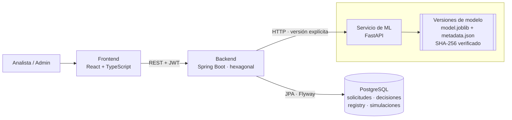

# Credit Scoring Engine

[](https://github.com/dvchinx/credit-scoring/actions/workflows/ci.yml)

Motor de scoring crediticio **explicable y auditable**. Evalúa el riesgo de un solicitante, decide (aprobar / rechazar / revisión manual) y **explica por qué**: qué variables subieron o bajaron el riesgo, con qué versión exacta del modelo y bajo qué política. Cada decisión se puede reconstruir meses después, como exige la regulación financiera ("right to explanation").

Proyecto de portafolio orientado a roles **Backend + IA**. El foco no es exprimir la métrica del modelo, sino el sistema alrededor: governance de decisiones automatizadas, versionado de modelos y trazabilidad.

## Qué demuestra

- **Decisiones explicadas por construcción:** ninguna decisión final existe sin su explicación SHAP y su versión de modelo. Lo garantizan el dominio y también la base de datos (`CHECK`, FK y tablas append-only con triggers).
- **Model registry con governance:** versiones inmutables con metadata completa (dataset, métricas, hiperparámetros, hash SHA-256 del artefacto). La activación es auditada, con motivo obligatorio, y el rollback consiste en activar de nuevo una versión anterior. El backend se niega a activar un artefacto que cambió desde su registro.
- **What-if analysis honesto:** simula cambios en la solicitud pasando por la misma derivación de variables y la misma política que una decisión real. Compara contra el escenario base evaluado con el mismo modelo y queda registrado para detectar "gaming".
- **Integración ML seria:** el backend Java y el servicio Python están separados. Un **test de contrato con Testcontainers** levanta el servicio de ML real y ejecuta el flujo completo en cada build.
- **Arquitectura hexagonal** en el backend (dominio sin Spring ni JPA), con tests unitarios e integración contra Postgres real.

## Arquitectura



| Componente | Responsabilidad |
| --- | --- |
| `backend/` | Orquestación, persistencia y governance: qué modelo está activo, política de crédito, decisiones explicadas append-only, simulaciones, auditoría |
| `ml-service/` | Solo scoring y explicabilidad: `/score`, `/explain`, `/what-if` y catálogo `/models`; verifica la integridad de cada artefacto antes de servirlo |
| `frontend/` | Solo presentación: muestra lo que decidió el backend, nunca recalcula decisiones ni umbrales |

Detalle completo, diagramas de secuencia, modelo de datos y decisiones de diseño: **[docs/architecture.md](docs/architecture.md)**. Referencia del API: **[docs/api.md](docs/api.md)**.

## Probarlo en 3 comandos

Requiere Docker.

```bash
cp .env.example .env                 # credenciales de desarrollo; cambia JWT_SECRET y ADMIN_PASSWORD fuera de local
docker compose up -d --build         # Postgres, servicio de ML, backend y frontend
./scripts/demo.sh                    # entrena, registra y activa un modelo; crea y evalúa solicitudes de ejemplo
```

Después, abre **<http://localhost:3000>** y entra como `admin` (contraseña: `ADMIN_PASSWORD` del `.env`). La demo deja tres solicitudes evaluadas (aprobada, revisión manual y rechazada) y una simulación what-if que cambia la decisión.

> Sin el dataset real, la demo entrena con un **dataset sintético** con relaciones de riesgo coherentes: más moras, más utilización y más endeudamiento suben el riesgo. Sirve para recorrer el sistema, pero sus métricas no dicen nada del mundo real. Para usar el dataset real ["Give Me Some Credit"](https://www.kaggle.com/c/GiveMeSomeCredit/data), descarga `cs-training.csv` en `ml-service/data/raw/` antes de ejecutar la demo.

### Desarrollo local (sin contenedores para el backend y el frontend)

```bash
docker compose up -d postgres ml-service
cd backend && bash mvnw spring-boot:run                          # API en :8080
cd frontend && cp .env.example .env && npm install && npm run dev  # SPA en :5173
```

`./scripts/demo.sh` también funciona con este modo: entrena en el contenedor del ML y habla con el backend en `:8080`.

Al arrancar por primera vez se crea el usuario `ADMIN` inicial con `ADMIN_USERNAME` / `ADMIN_PASSWORD` del `.env`; no hay credenciales en el código.

## Tests

| Suite | Comando | Qué cubre |
| --- | --- | --- |
| Backend unitarios | `cd backend && bash mvnw test` | Dominio (política, invariantes de decisiones, derivación de variables), casos de uso con Mockito, adaptadores HTTP |
| Backend integración | `cd backend && bash mvnw verify` | Testcontainers con Postgres real: API completa, seguridad, migraciones, triggers append-only y `CHECK` |
| Contrato backend ↔ ML | incluido en `verify` | `MlServiceContractIT` construye el servicio de ML desde su Dockerfile, entrena al arrancar y ejecuta evaluación y what-if de punta a punta |
| Servicio de ML | `cd ml-service && pytest` | API, registry con integridad de artefactos, entrenamiento inmutable, SHAP en forma cerrada vs. `shap.LinearExplainer` |
| Frontend | `cd frontend && npm test` | Rutas reales sobre un `fetch` simulado: sesión y expiración, errores por campo, decisiones, what-if, permisos por rol |

El [workflow de CI](.github/workflows/ci.yml) ejecuta las tres suites en cada push y pull request.

¿Por qué un test de contrato aparte? Durante tres fases todos los tests pasaban, pero ninguna evaluación funcionaba contra el ML real: el cliente HTTP del JDK negociaba HTTP/2 y uvicorn descartaba el cuerpo del POST. Los mocks no abren conexiones, así que no podían verlo. La historia completa está en [docs/architecture.md](docs/architecture.md#lección-el-test-de-contrato).

## Stack

- **Backend:** Java 21 · Spring Boot 4 (Web, Data JPA, Security con JWT, Validation) · Flyway · JUnit 5, Mockito, Testcontainers
- **Base de datos:** PostgreSQL 16
- **ML:** Python 3.12 · FastAPI · scikit-learn (regresión logística) · SHAP · pytest
- **Frontend:** React 19 · TypeScript · Vite · React Router · TanStack Query · Recharts · Vitest + Testing Library
- **Infraestructura:** Docker Compose · nginx · GitHub Actions
- **Observabilidad:** Spring Actuator y logs estructurados en JSON

## Estructura del repositorio

```text
├── backend/          API Spring Boot (hexagonal: domain → application → infrastructure por feature)
├── ml-service/       Servicio de ML: entrenamiento, registry en disco y API FastAPI
├── frontend/         SPA React + TypeScript
├── docs/             Arquitectura, decisiones de diseño y referencia del API
├── scripts/demo.sh   Deja el sistema listo para explorar
└── docker-compose.yml
```

## Roadmap

1. ✅ **Esqueleto backend:** CRUD de solicitudes, JWT, Postgres.
2. ✅ **Servicio de ML base:** FastAPI con `/score` sobre "Give Me Some Credit".
3. ✅ **Explicabilidad:** SHAP exacto y decisiones explicadas append-only.
4. ✅ **Model registry y versionado:** versiones inmutables con hash verificado, activación auditada y rollback.
5. ✅ **What-if analysis:** simulación con la misma derivación y política que una decisión real, registrada para auditoría.
6. ✅ **Frontend:** SPA con decisiones explicadas, simulador, registry y dashboard de auditoría.
7. ✅ **Pulido:** test de contrato con Testcontainers, stack completo en Docker Compose con demo, CI y documentación con diagramas.

## Licencia

Distribuido bajo la licencia **GPL-3.0**. Ver [LICENSE](LICENSE).
