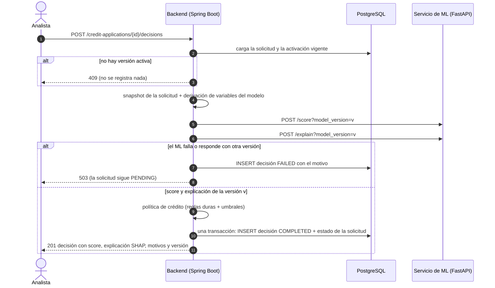
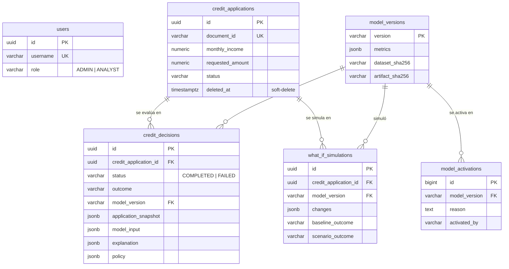

# Arquitectura y decisiones de diseño

Detalle técnico del motor de scoring. Para una visión general y cómo levantarlo, ver el [README](../README.md).

## Responsabilidades

- **Backend (Spring Boot):** orquestación, persistencia y governance. Decide qué versión de modelo está activa, aplica la política de crédito, persiste cada decisión con su explicación y registra todo de forma append-only.
- **Servicio de ML (FastAPI):** solo scoring y explicabilidad. Sirve la versión exacta que se le pide, verificando la integridad del artefacto; no tiene noción de "versión activa".
- **Frontend (React):** solo presentación. Muestra lo que decidió el backend; no recalcula decisiones ni umbrales.

## Secuencia de una evaluación



Las llamadas al ML ocurren **fuera** de la transacción de base de datos: no se retiene una conexión mientras se espera al servicio externo.

## Flujo de evaluación (`POST /credit-applications/{id}/decisions`)

1. Se carga la solicitud y se toma un **snapshot** de sus datos.
2. Se fija la **versión de modelo activa** en ese momento. Si no hay ninguna, la API responde `409` y no se registra nada.
3. Se traduce la solicitud a las variables del modelo (ver tabla abajo).
4. Se llama a `/score` y a `/explain` del servicio de ML **con esa versión explícita**, fuera de cualquier transacción de base de datos.
5. Si el ML falla, no responde, o responde con una versión distinta de la pedida, se registra una decisión `FAILED` con el motivo, la solicitud sigue `PENDING` y la API responde `503`.
6. Si todo va bien, la política de crédito (umbrales externalizados) produce `APPROVED` / `REJECTED` / `MANUAL_REVIEW` con sus motivos.
7. En una sola transacción se inserta la decisión y se actualiza el estado de la solicitud.

Cada evaluación crea una decisión nueva; las anteriores se conservan. La tabla `credit_decisions` es **append-only**: un trigger de Postgres rechaza cualquier `UPDATE` o `DELETE`, y un `CHECK` impide guardar una decisión `COMPLETED` sin score, explicación y versión de modelo.

## Model registry y versionado

El backend es la **única fuente de verdad** de qué versión de modelo decide; el servicio de ML no tiene noción de "versión activa" y sirve la versión exacta que se le pide.

```
entrenar (ml-service)  ──►  models/<version>/  model.joblib + metadata.json   (inmutable; nunca se sobreescribe)
        │
POST /model-versions   ──►  el backend lee la metadata desde GET /models/{version} y la guarda en model_versions
        │
POST /model-activations ─►  {version, reason}: se inserta en model_activations; la última activación es la vigente
        │
POST .../decisions     ──►  /score?model_version=<activa>  y  /explain?model_version=<activa>
```

- **Metadata por versión:** algoritmo e hiperparámetros, fecha de entrenamiento, huella SHA-256 del dataset, filas de entrenamiento/test y tasa de default, métricas (ROC-AUC, Brier) y variables de entrada. La metadata se toma del servicio de ML, nunca del cliente que registra.
- **Integridad del artefacto:** al entrenar se calcula el SHA-256 de `model.joblib`. El servicio de ML se niega a servir una versión cuyo archivo ya no coincide (`409`). El backend no registra artefactos alterados y, al activar, exige que el hash que sirve el ML sea **el mismo que se registró**.
- **Compatibilidad:** solo se registran versiones cuyas variables de entrada coinciden con las que el backend sabe calcular.
- **Activación auditada:** cada activación guarda quién, cuándo y por qué (motivo obligatorio). Un rollback es activar de nuevo una versión anterior; el historial completo responde "qué modelo decidía en tal fecha".
- **Append-only:** `model_versions` y `model_activations` rechazan `UPDATE`/`DELETE` por trigger, y `credit_decisions.model_version` tiene FK a `model_versions`.
- Registrar y activar requieren rol `ADMIN`; consultar, cualquier usuario autenticado.

### Ciclo de vida de una versión de modelo

```mermaid
stateDiagram-v2
    [*] --> Entrenada: python -m training.train (carpeta inmutable + SHA-256)
    Entrenada --> Registrada: POST /model-versions (ADMIN; metadata leída del ML)
    Registrada --> Activa: POST /model-activations (ADMIN; motivo obligatorio; hash verificado)
    Activa --> Registrada: se activa otra versión
    Registrada --> Activa: rollback = activarla de nuevo
    note right of Activa
        Solo una versión activa a la vez:
        la última fila de model_activations.
        Las decisiones guardan la versión que usaron.
    end note
```



## What-if analysis (`POST /credit-applications/{id}/what-if`)

Responde "¿qué pasaría si…?" sobre una solicitud: qué decisión tomaría el sistema si el ingreso fuera mayor, el monto menor o la utilización de crédito más baja. Sirve al solicitante ("qué mejorar") y a auditoría interna.

```json
{"monthlyIncome": 4200, "creditHistory": {"revolvingUtilization": 0.10}}
```

- **Se simulan datos de la solicitud, no variables crudas del modelo:** los cambios pasan por la misma derivación (`debt_ratio` con la cuota nueva) y la misma política que una decisión real, reglas duras incluidas. Simular un monto mayor puede rechazar por endeudamiento aunque el riesgo del modelo no cambie. Variables simulables: ingreso, monto, plazo, deuda existente, dependientes y todo `creditHistory`. Un campo ausente mantiene su valor real.
- **Comparación justa:** el escenario real y el simulado se evalúan en la misma llamada a `/what-if` del ML, con la versión activa y la política vigente. La diferencia se debe solo a los cambios, no a que el modelo haya cambiado desde la última decisión.
- **Atribución exacta:** con un modelo lineal, cambiar una variable solo mueve su propia contribución SHAP. `featureImpacts` muestra, por variable del modelo, el valor y el SHAP en ambos escenarios y su diferencia (`shapDelta`). Cambiar `monthlyIncome` mueve dos variables, `monthly_income` y `debt_ratio`, porque el endeudamiento depende del ingreso.
- **Nunca es una decisión:** no crea registros en `credit_decisions` ni cambia el estado de la solicitud.
- **Auditable:** cada simulación se guarda en `what_if_simulations` (append-only, con quién, cuándo, qué cambió y ambos resultados). Las columnas `baseline_outcome`/`scenario_outcome` permiten encontrar rápido las simulaciones que cambiaron el resultado, por ejemplo para detectar si alguien probó variantes hasta encontrar una que aprueba y luego editó la solicitud con esos valores.

Respuesta (resumida, valores ilustrativos):

```json
{
  "modelVersion": "20261004T120000Z",
  "changes": [{"variable": "creditHistory.revolvingUtilization", "baselineValue": 0.35, "scenarioValue": 0.10}],
  "baseline": {"outcome": "MANUAL_REVIEW", "probabilityOfDefault": 0.41, "riskScore": 625, "reasons": ["..."]},
  "scenario": {"outcome": "APPROVED", "probabilityOfDefault": 0.27, "riskScore": 701, "reasons": ["..."]},
  "decisionChanged": true,
  "probabilityOfDefaultDelta": -0.14,
  "featureImpacts": [
    {"feature": "revolving_utilization_of_unsecured_lines", "baselineValue": 0.35, "scenarioValue": 0.10,
     "baselineShap": 0.21, "scenarioShap": -0.43, "shapDelta": -0.64, "changed": true}
  ]
}
```

## De la solicitud a las variables del modelo

El modelo se entrenó con variables tipo buró de crédito. La solicitud incluye un bloque `creditHistory` con ellas, y el resto se deriva:

| Variable del modelo | Origen |
|---|---|
| `age` | Años cumplidos a la fecha de evaluación, desde `birthDate` |
| `debt_ratio` | (`existingMonthlyDebt` + `requestedAmount` / `loanTermMonths`) / `monthlyIncome`: endeudamiento **incluyendo la cuota nueva** (estimada sin intereses) |
| `monthly_income`, `number_of_dependents` | Directo de la solicitud |
| `revolving_utilization_of_unsecured_lines` | `creditHistory.revolvingUtilization` |
| `number_of_open_credit_lines_and_loans` | `creditHistory.openCreditLines` |
| `number_real_estate_loans_or_lines` | `creditHistory.realEstateLoans` |
| `number_of_time_30_59_days_past_due_not_worse` | `creditHistory.latePayments30To59Days` |
| `number_of_time_60_89_days_past_due_not_worse` | `creditHistory.latePayments60To89Days` |
| `number_of_times_90_days_late` | `creditHistory.latePayments90DaysOrMore` |

`employmentYears` se guarda en el snapshot pero el modelo actual no lo usa.

## Política de crédito

Configurable por variables de entorno (ver `.env.example`); se guarda con cada decisión para saber qué umbrales se aplicaron:

1. **Reglas duras**, con rechazo sin importar el score: edad mínima (`CREDIT_POLICY_MIN_APPLICANT_AGE`, 18) y endeudamiento máximo con la cuota nueva (`CREDIT_POLICY_MAX_DEBT_RATIO`, 50%).
2. Probabilidad de default ≥ `CREDIT_POLICY_REJECT_MIN_PD` (0.60): `REJECTED`.
3. Probabilidad de default ≤ `CREDIT_POLICY_APPROVE_MAX_PD` (0.30): `APPROVED`.
4. Entre ambos umbrales: `MANUAL_REVIEW`.

Una política inválida (p. ej. umbral de aprobación ≥ umbral de rechazo) impide arrancar la aplicación.

> El modelo se entrena con `class_weight="balanced"`, así que sus probabilidades no están calibradas a la tasa real de default (~7%). Los umbrales por defecto son ilustrativos y deben revisarse con cada versión del modelo.

## Modelo de datos

Todas las tablas de decisiones, simulaciones y registry son **append-only**: un trigger de Postgres rechaza `UPDATE` y `DELETE`.



Restricciones que la base de datos hace cumplir, aunque falle el código:
- `CHECK`: una decisión `COMPLETED` siempre tiene resultado, probabilidad, score, versión de modelo y explicación; una `FAILED` siempre tiene motivo.
- `FK credit_decisions.model_version → model_versions` (`NOT VALID`: aplica a toda fila nueva sin reescribir las decisiones previas al registry).
- `CHECK` de formato SHA-256 en los hashes y motivo no vacío en las activaciones.

## Frontend (`frontend/`)

SPA en React + TypeScript que consume **solo** el API de Spring Boot. Es una capa de presentación: muestra lo que decidió el backend y no recalcula decisiones, scores ni umbrales.

| Pantalla | Qué muestra |
|---|---|
| Login | Inicio de sesión; si el JWT expira o el backend responde `401`, vuelve al login con aviso y recuerda la página |
| Solicitudes | Listado paginado; alta y edición con el bloque `creditHistory`; los errores de validación del backend se muestran junto a cada campo |
| Detalle | Datos de la solicitud, botón "Evaluar con el modelo activo", historial de decisiones (incluidos los intentos `FAILED` y su motivo) |
| Decisión | Resultado, probabilidad de default, score, motivos de la política, versión de modelo y gráfico de contribuciones SHAP |
| Simulador what-if | Solo se envían las variables cambiadas; compara la decisión real con la simulada y el efecto en cada variable del modelo |
| Modelos (`ADMIN`) | Versiones registradas con métricas, hash del artefacto, versión activa e historial de activaciones |
| Auditoría | Decisiones por resultado y por versión de modelo, intentos fallidos recientes, simulaciones que cambiaron el resultado |

Decisiones de diseño:
- **JWT solo en memoria** (no en `localStorage`), para reducir la exposición ante XSS. Contrapartida asumida: al recargar la página hay que iniciar sesión de nuevo.
- **Roles:** el frontend oculta la sección de modelos a los `ANALYST` solo por usabilidad; quien autoriza es el backend (`403`).
- **URL del API** por `VITE_API_BASE_URL`, incrustada en el build. El backend solo acepta peticiones de navegador desde los orígenes de `CORS_ALLOWED_ORIGINS`.
- **Carga diferida:** las páginas con gráficos (Recharts) se cargan bajo demanda, así que login y listado no descargan la librería de gráficos.
- Organizado por feature (`features/auth`, `credit-applications`, `decisions`, `what-if`, `models`, `audit`) con un cliente HTTP tipado (`src/api`) cuyos tipos reflejan los DTOs del backend.

## Backend: arquitectura hexagonal (ports & adapters)

Cada feature (`auth`, `creditapplication`) se organiza en tres capas internas, en vez de capas técnicas genéricas a nivel raíz:

```
com.florez.backend
├── config/                 Wiring de Spring: seguridad, auditoría JPA, conexión de los servicios de "application" con sus adapters
├── auth/
│   ├── domain/              Modelo (User, Role) y ports (in: casos de uso: out: contratos hacia infraestructura) — sin dependencias de Spring/JPA
│   ├── application/         AuthService: implementa los casos de uso orquestando el dominio a través de los ports
│   └── infrastructure/
│       ├── in/web/          AuthController + DTOs
│       └── out/             Adapters: persistencia (JPA), seguridad (JWT, BCrypt)
├── creditapplication/       Mismo esquema domain → application → infrastructure
├── scoring/                 Evaluación y decisiones: política de crédito, explicación SHAP, cliente HTTP del servicio de ML,
│                            persistencia append-only de decisiones
├── modelregistry/           Versiones de modelo registradas, activaciones auditadas, catálogo del servicio de ML
├── whatif/                  Simulación de escenarios sobre una solicitud y su registro de auditoría
├── audit/                   Resumen de solo lectura (agregados SQL) para el dashboard de auditoría
└── common/                  Excepciones de dominio, manejo de errores centralizado, entidad base de auditoría JPA,
                             TransactionRunner (port para delimitar transacciones sin acoplar los casos de uso a Spring)
```

**Regla de dependencia:** `domain` no conoce Spring ni JPA; `application` solo depende de `domain` (los ports); `infrastructure` implementa los ports de salida y consume los casos de uso, nunca al revés.

## Decisiones de ingeniería

| Decisión | Por qué | Contrapartida |
|---|---|---|
| Regresión logística en lugar de XGBoost | Interpretabilidad: los valores SHAP son exactos y en forma cerrada (`φᵢ = βᵢ·zᵢ`), y cambiar una variable en un what-if solo mueve su propia contribución | Algo menos de capacidad predictiva que un modelo de árboles |
| SHAP en forma cerrada en runtime, `shap` solo en tests | Imagen de producción ligera (sin numba); un test verifica que coincide con `shap.LinearExplainer` (1e-9) | Si se cambia a un modelo no lineal hay que pasar a `TreeExplainer` |
| El backend gobierna la versión activa; el ML sirve versiones explícitas | Una sola fuente de verdad, auditada con motivo; rollback trivial | Registrar y activar es un paso manual de un `ADMIN` |
| Tablas append-only con triggers | La trazabilidad no depende de que el código se porte bien | Corregir un dato implica una fila nueva, no un `UPDATE` |
| Intentos fallidos registrados como `FAILED` | La auditoría ve también lo que no se pudo decidir y por qué | Más filas en `credit_decisions` |
| `POST` para what-if, con registro | Lleva un cuerpo y queda auditado (detección de "gaming") | No es cacheable como un `GET` |
| JWT en memoria en el frontend | Menor exposición ante XSS | Recargar la página obliga a iniciar sesión |
| Cliente HTTP del backend en HTTP/1.1 | El `HttpClient` del JDK intenta HTTP/2 (h2c) y uvicorn descarta el cuerpo del POST | — |

### Lección: el test de contrato

Durante tres fases, todos los tests pasaban y sin embargo **ninguna evaluación funcionaba contra el servicio de ML real**: el cliente HTTP del JDK negociaba HTTP/2 por `Upgrade: h2c`, uvicorn no lo soporta y descartaba el cuerpo del POST (`422`). Los tests del backend sustituían el ML con `MockRestServiceServer`, que nunca abre una conexión. Se detectó con un smoke test manual end-to-end; desde entonces `MlServiceContractIT` (Testcontainers) construye el servicio de ML real desde su Dockerfile y ejecuta el flujo completo en cada `mvnw verify`, y un test de regresión verifica que el cliente no envía `Upgrade`.
